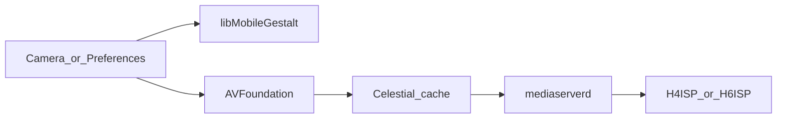

# 60fps

Enable rear 60 fps video on cameras that already have the mode in firmware but hide it.

- 720p60 on iPhone 4s (`iPhone4,1`), H4ISP, through iOS 9.3.6
- 1080p60 on iPhone 5s (`iPhone6,1` / `iPhone6,2`), H6ISP, through iOS 12.5.8

iPhone SE (1st generation) is not a target. Stock already has 1080p60 and 4K30.

## Not possible

- **4K30 on iPhone 5s:** the rear sensor has no 3840x2160 mode. Largest 16:9 readout is 2112x1188; largest overall is 3264x2448. See [sensors.md](sensors.md).
- **4K60 on iPhone SE:** experimental 3840x2160 exists, but it uses the high-speed camera config, not stock 4K30. Unhiding it is not 4K60. See [sensors.md](sensors.md).

## How it works

`H4ISP.mediacapture` / `H6ISP.mediacapture` build the format list in `CopySupportedFormatsArray`. Hidden 60 fps rows are marked `Experimental`. This tweak removes that flag and attaches `AVCaptureSessionPresetHigh60`. `postinst` deletes `com.apple.celestial.plist` and kills `mediaserverd` so Celestial recaches the list.

Camera UI reads MobileGestalt for max FPS. The tweak answers:

- `RearFacingCamera60fpsVideoCaptureCapability` = true
- `0/7QNywWU4IqDcyvTv9UYQ` (`RearFacingCameraVideoCapture720pMaxFPS`) = 60 on 4s when `MGGetSInt32Answer` exists (iOS 9+)
- `jBGZJ71pRJrqD8VZ6Tk2VQ` (`RearFacingCameraVideoCapture1080pMaxFPS`) = 60 on 5s

On 5s, High Profile H.264 is required for 1080p60. The tweak marks the unhidden format `HighProfileH264Supported`, returns YES from `FigCaptureSourceVideoFormat`, and relaxes `AVCaptureFigVideoDevice` encoder helpers in Camera and mediaserverd.

